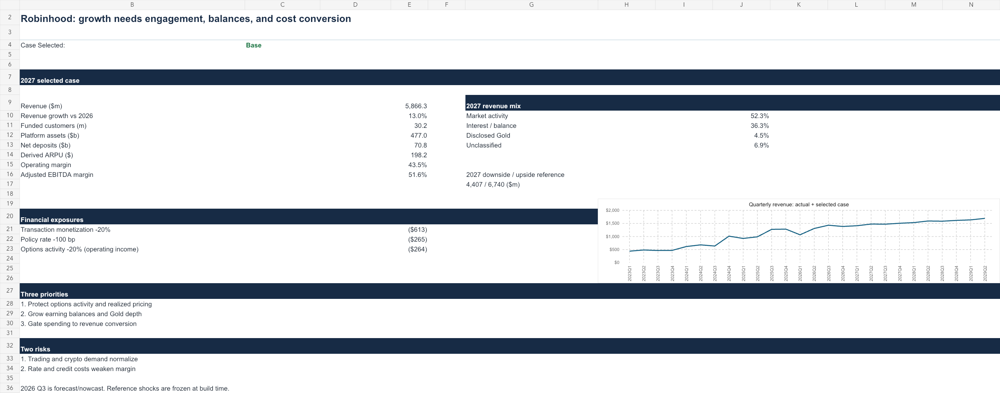
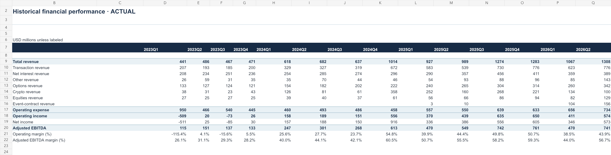
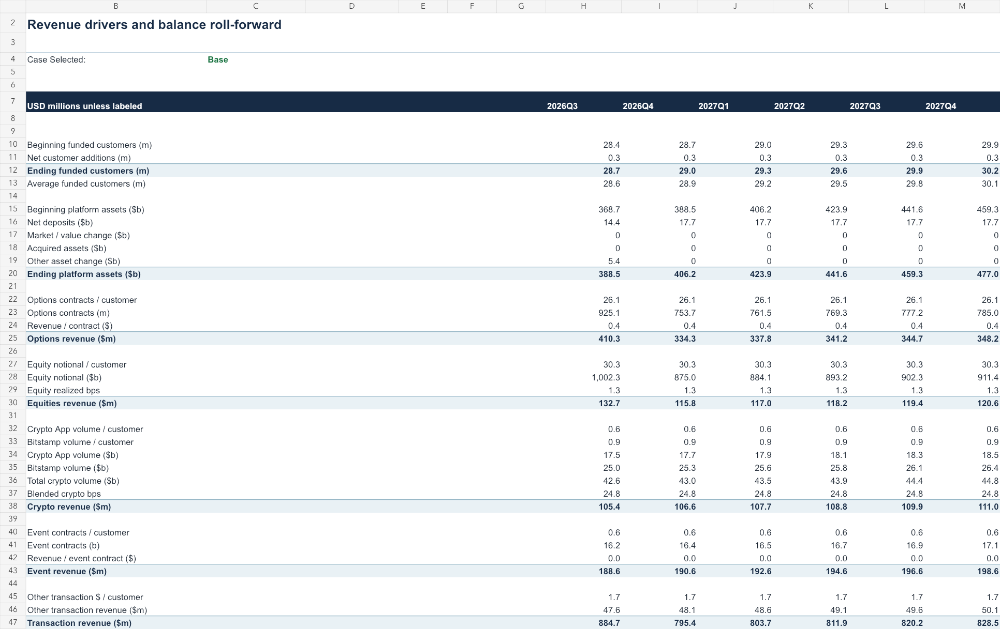
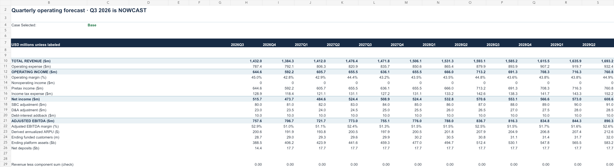
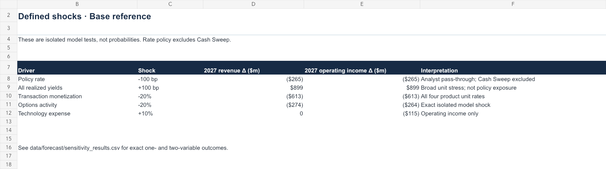
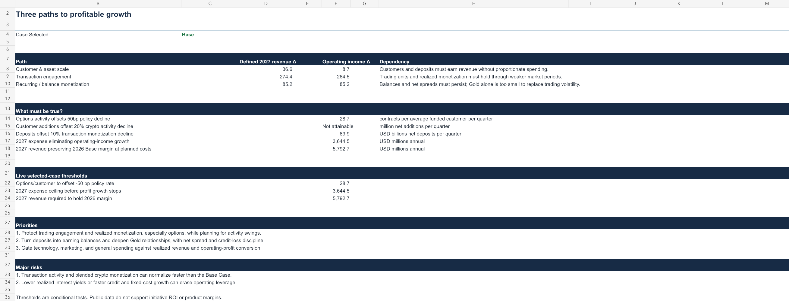
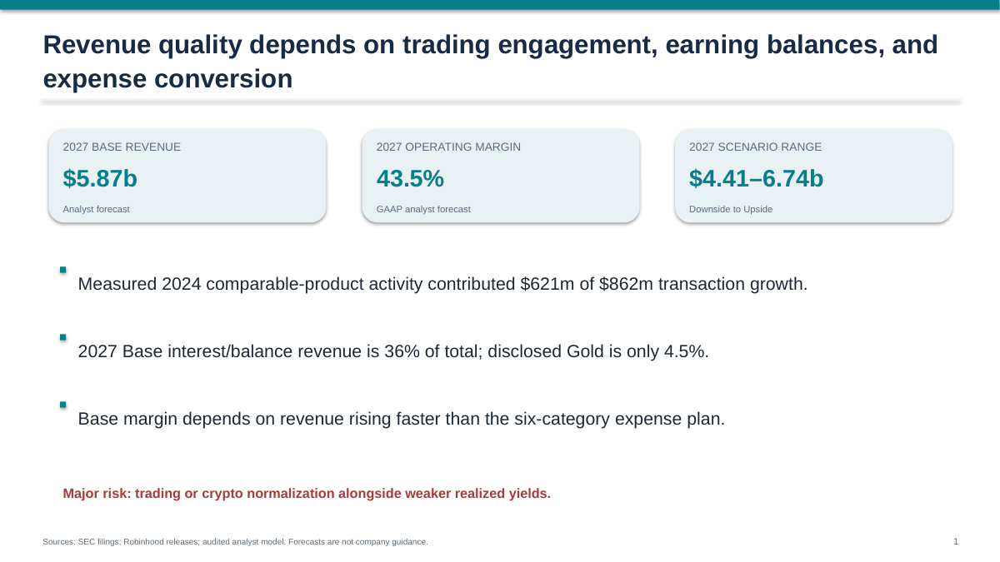

# Robinhood Strategic Finance & Operating Model

### “What Drives Robinhood's Next Phase of Profitable Growth?”

Built a **14-quarter historical financial model** and **12-quarter driver-based forecast** using Robinhood SEC filings, investor-relations releases, and operating metrics to analyze revenue drivers, operating leverage, scenario risk, and strategic growth priorities.

**Decision supported:** Which operating and financial drivers convert growing customers, assets, and product breadth into sustainable revenue and operating profit?

## Key questions and findings

- **What drove growth?** Measured activity accounted for $621m of the $862m 2024 versus 2023 transaction-revenue increase. Later acquisitions and new products require a disclosed residual. [Historical analysis](reports/HISTORICAL_ANALYSIS.md).
- **What does Base require?** $5.87b modeled 2027 revenue at 43.5% GAAP operating margin; $6.33b at 43.9% in 2028. The 2027 Downside–Upside range is $4.41b–$6.74b. These are **analyst scenarios, not company guidance**. [Forecast results](reports/FORECAST_RESULTS.md).
- **What matters most?** Trading engagement and monetization, earning-balance capture and net yield, and six-category expense conversion. The 2027 -100 bp policy-rate case is -$265m; the separate all-component realized-yield stress is broader. [Decision framework](reports/STRATEGIC_DECISION.md); [rate audit](reports/INTEREST_SENSITIVITY_AUDIT.md).

## Model outputs

| Deliverable | Decision use |
|---|---|
| [Excel operating model](models/Robinhood_Strategic_Finance_Model.xlsx) | Trace actuals, edit one selected case, compare reference scenarios and break-even conditions |
| [Executive deck](presentation/Robinhood_Strategic_Finance_Executive_Deck.pdf) | Eight-slide CFO narrative with conclusion headlines |
| [Management memo](reports/MANAGEMENT_MEMO.md) | Three priorities, two risks and monitoring KPIs |
| [Interview guide](reports/INTERVIEW_GUIDE.md) | Defend source choices, equations, limitations and recommendation |

## Screenshots









## Architecture and methods

SEC and company releases feed a source-registered historical pipeline (2023 Q1–2026 Q2). July/August 2026 are **partial-quarter operating observations**; Q3 2026 financials are **FORECAST/NOWCAST**. Options, crypto, equity and event revenue use product activity and realized monetization; net interest uses average earning balances and company-specific yields; Gold uses subscriber economics. Six operating-expense categories and GAAP-to-adjusted EBITDA reconciliation are explicit. [Forecast method](reports/FORECAST_METHOD.md) explains assumptions; [data quality](DATA_QUALITY_REPORT.md) and [structural breaks](reports/STRUCTURAL_BREAKS.md) explain coverage.

The workbook's selected case is live. Its Base/Upside/Downside comparison tables are **build-time reference snapshots** refreshed by `python -m src.phase5`; editing workbook assumptions does not revise those snapshots. Sensitivity and break-even results are conditional tests, not probabilities or initiative ROI.

## Run and verify

Install Python 3.11+ packages with `pip install -r requirements.txt`. The workbook builder also uses the bundled `@oai/artifact-tool` runtime supplied in Codex; deck export uses `python-pptx` and LibreOffice `soffice` on PATH. Then run:

```bash
python -m src.phase5
python -m unittest discover -s tests -v
```

Source publications are frozen at **September 28, 2026**. Historical values are REPORTED or DERIVED; future outputs are analyst ASSUMPTION or ESTIMATED calculations. Public data do not provide product-active users, product margins, cohort retention, internal budgets or initiative ROI. The [CFO challenge](reports/CFO_CHALLENGE.md) describes how these gaps could change the decision.

This is an independent portfolio project based solely on publicly available information and is not affiliated with Robinhood Markets, Inc.
