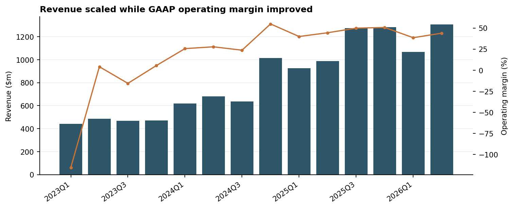
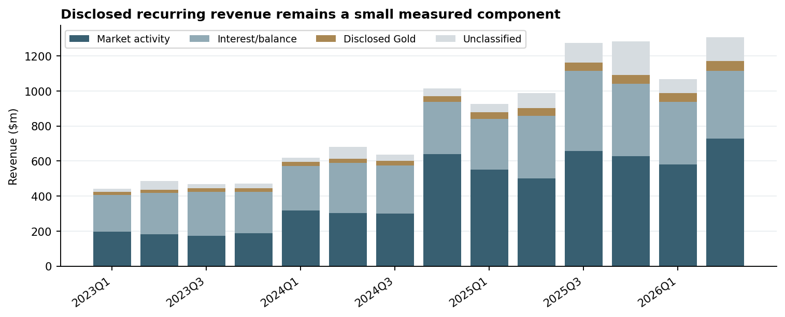
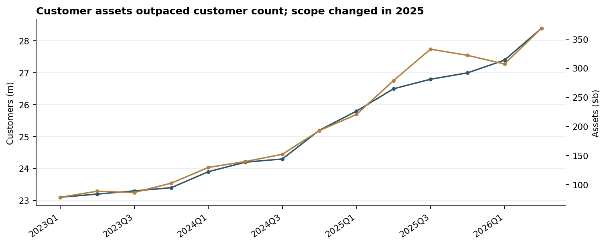
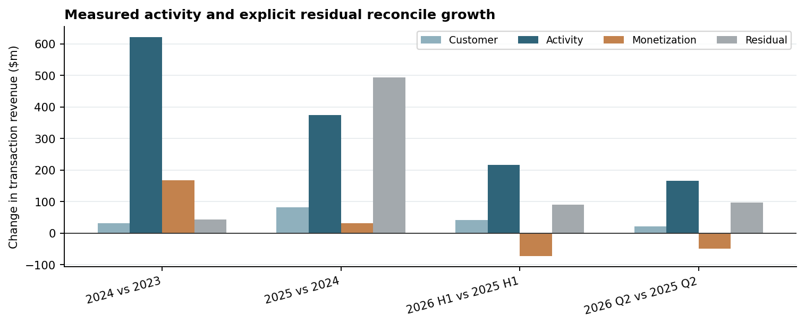
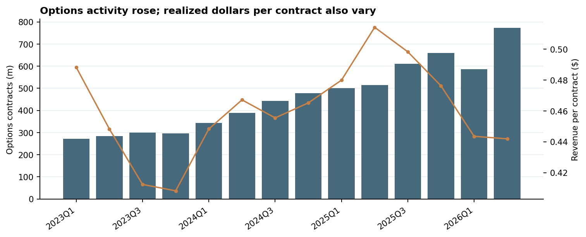
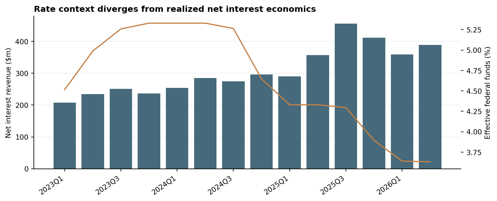

# Historical financial analysis

**Period:** 2023 Q1–2026 Q2. **Basis:** reported company and SEC facts plus labeled arithmetic. **Purpose:** select drivers for a later forecast, not recommend an investment or management action.

## Executive takeaways

1. **FACT:** Revenue rose from $2,951m in 2024 to $4,473m in 2025; transaction revenue rose from $1,647m to $2,628m. **DERIVED RESULT:** Revenue grew 51.6% and transaction revenue grew 59.6%. **INTERPRETATION:** Activity and product expansion matter more than funded-customer growth alone. [2025 10-K/A](https://www.sec.gov/Archives/edgar/data/1783879/000178387926000029/hood-20251231.htm); [financial KPI table](../data/analysis/financial_kpis_quarterly.csv).
2. **DERIVED RESULT:** The exact 2024 vs 2023 transaction bridge attributes $620.8m of the $862.0m change to measured activity for comparable products. The 2025 bridge has a $493.0m residual. **INTERPRETATION:** The later residual contains new products, acquisition scope, and undisclosed components; it is not evidence that one product alone drove growth. [Bridge table](../data/analysis/revenue_growth_bridges.csv).
3. **FACT:** Quarter-end customer assets were $102.6b at 2023 Q4 and $322.1b at 2025 Q4, while funded customers rose from 23.4m to 27.0m. **INTERPRETATION:** Assets per customer expanded, but acquired assets and market gains are included. The 2025 filing attributes $51.8b to acquired assets in its asset roll-forward. [2025 10-K/A](https://www.sec.gov/Archives/edgar/data/1783879/000178387926000029/hood-20251231.htm); [customer table](../data/analysis/monetization_metrics_quarterly.csv).
4. **FACT:** Average disclosed interest-earning assets increased from $51,388.0m in 2025 Q2 to $66,383.0m in 2026 Q2, while net interest revenue rose from $357.0m to $389.0m. **DERIVED RESULT:** The matched interest-asset revenue bridge is +$90.5m balance effect and -13.5m yield/mix effect. **INTERPRETATION:** Balance growth offset lower realized yield; the net-interest remainder includes securities lending and financing costs. [2026 Q2 10-Q](https://www.sec.gov/Archives/edgar/data/1783879/000178387926000114/hood-20260630.htm); [KPI table](../data/analysis/financial_kpis_quarterly.csv).
5. **DERIVED RESULT:** 2025 revenue increased $1,522.0m while operating expense increased $482.0m, yielding $1,040.0m of additional GAAP operating income and a 68.3% annual incremental operating margin. **INTERPRETATION:** Historical operating leverage improved, though acquisition integration and expense mix limit extrapolation. [2025 10-K/A](https://www.sec.gov/Archives/edgar/data/1783879/000178387926000029/hood-20251231.htm); [leverage table](../data/analysis/operating_leverage_quarterly.csv).

## Revenue growth and mix

**FACT:** Full-year 2023, 2024, and 2025 revenues were $1,865m, $2,951m, and $4,473m. **DERIVED RESULT:** In 2026 Q2, explicitly identified market-activity revenue was 55.6% of total, net interest was 29.7%, disclosed Gold subscription was 4.1%, and 10.6% was unclassified. **INTERPRETATION:** Disclosed Gold is a small, measurable recurring component. Unclassified revenue cannot be treated as durable. [Revenue mix table](../data/analysis/revenue_mix_quarterly.csv); [2026 Q2 revenue note](https://www.sec.gov/Archives/edgar/data/1783879/000178387926000114/hood-20260630.htm).

Gold subscription revenue totaled $179.0m in 2025, or 4.0% of total revenue, versus $109m in 2024. This supports a growing but still modest disclosed recurring revenue line; it does not make the rest of other revenue recurring. [2025 10-K/A](https://www.sec.gov/Archives/edgar/data/1783879/000178387926000029/hood-20251231.htm); [revenue mix table](../data/analysis/revenue_mix_quarterly.csv).

Robinhood does not disclose product-level contribution margin in this historical series, so the bucket mix cannot be converted into bucket profit. The consolidated operating-margin analysis below is the supported profitability view.

## Customer and asset monetization

**DERIVED RESULT:** Assets per quarter-end funded customer rose from $4,385 to $11,930. Derived annualized revenue per average customer was $190.8 in 2025 Q4 versus company-reported quarterly ARPU of $191. The small difference reflects rounded company customer and revenue inputs. **INTERPRETATION:** Customer balances and monetization increased together, but assets include acquisitions, valuation changes, and non-interest-earning assets; the relationship is not causal. [Customer table](../data/analysis/monetization_metrics_quarterly.csv); [2025 asset roll-forward](https://www.sec.gov/Archives/edgar/data/1783879/000178387926000029/hood-20251231.htm).

The same-quarter and one-quarter-lag correlations below describe deposits and revenue, but do not establish whether deposits lead monetization. Acquired assets and market moves also change asset balances independently of deposits. [KPI table](../data/analysis/financial_kpis_quarterly.csv).

## Trading economics and growth bridge

**DERIVED RESULT:** Q2 2026 options revenue per contract was $0.442. Its crypto blended revenue/notional was 24.8 bps; this is an aggregate rate across the acquired Bitstamp scope and should not be read as a stable price. Activity per funded customer is a scale-normalized proxy, not product-user frequency. [Trading table](../data/analysis/monetization_metrics_quarterly.csv); [2026 Q2 release](https://www.globenewswire.com/news-release/2026/07/29/3335576/0/en/robinhood-reports-second-quarter-2026-results.html).

**Method:** For each comparable product, R = C × (V/C) × (R/V), where C is the mean of quarter-average funded customers across the window. Ordered effects are `(C1−C0)×A0×M0`, `C1×(A1−A0)×M0`, and `C1×A1×(M1−M0)`; A=V/C and M=R/V. The transaction residual equals the reported total change less all measured product effects. This identity reconciles exactly, but attribution changes with ordering. New products, unknown units, and acquisition-scope changes stay in residual. [Bridge table](../data/analysis/revenue_growth_bridges.csv).

## Net interest economics

**DERIVED RESULT:** Q2 2025 to Q2 2026 interest-asset implied yield moved from 2.41% to 2.33%, while the quarterly average effective federal funds rate moved from 4.33% to 3.63%. **INTERPRETATION:** Federal funds is external context and is not Robinhood's realized yield. The interest-asset component excludes securities lending and credit-facility expense, so its balance/yield bridge must not be labeled a full net-interest bridge. [2026 Q2 10-Q](https://www.sec.gov/Archives/edgar/data/1783879/000178387926000114/hood-20260630.htm); [FRED DFF](https://fred.stlouisfed.org/series/DFF).

**FACT:** Within that matched disclosure, average margin balances rose from $8,912.0m to $19,015.0m, cash/deposit balances from $11,815.0m to $18,001.0m, while cash sweep averaged $30,148.0m and $28,020.0m respectively. **INTERPRETATION:** Balance mix is changing alongside rates; a single policy-rate multiplier would hide these channels. [2026 Q2 10-Q](https://www.sec.gov/Archives/edgar/data/1783879/000178387926000114/hood-20260630.htm); [component fact table](../data/disclosed_components.csv).

## Operating leverage and descriptive relationships

**FACT:** Q2 2026 reported revenue was $1,308.0m, operating expense $734.0m, and adjusted EBITDA $741.0m. **DERIVED RESULT:** GAAP operating margin was 43.9% and adjusted EBITDA margin was 56.7%. **INTERPRETATION:** Brokerage costs have some activity-linked behavior, while technology and G&A show a larger base; historical evidence is insufficient to assign hard fixed/variable percentages. Credit-loss provision grew with lending exposure and is disclosed for only seven quarters in the Phase 2 dataset. [2026 Q2 filing](https://www.sec.gov/Archives/edgar/data/1783879/000178387926000114/hood-20260630.htm); [leverage table](../data/analysis/operating_leverage_quarterly.csv).

**FACT:** From 2024 to 2025, brokerage/transaction expense grew 29%, technology/development 10%, operations 16%, marketing 47%, G&A 38%, and credit-loss provision 50%, versus 52% total revenue growth. **INTERPRETATION:** Brokerage and operations show semi-variable behavior; technology appears base-heavy over this window. Marketing is a management-controlled spend line, while credit loss follows lending exposure and G&A includes compensation and acquisition effects. These are qualitative observations, not fitted cost elasticities. [2025 10-K/A](https://www.sec.gov/Archives/edgar/data/1783879/000178387926000029/hood-20251231.htm).

The following Pearson correlations are **descriptive only**; 14 quarters, trend, acquisitions, and definition changes make them unsuitable as causal or forecast coefficients. Total transaction revenue includes products other than options, so its relationship with options contracts is an activity proxy.

| Pair | n | r |
|---|---:|---:|
| Revenue / funded customers | 14 | 0.96 |
| Revenue / platform assets (joined scope) | 14 | 0.97 |
| Transaction revenue / options contracts | 14 | 0.94 |
| ARPU / options contracts | 14 | 0.94 |
| Net deposits / revenue, same quarter | 14 | 0.93 |
| Operating margin / revenue | 14 | 0.69 |
| Prior-quarter deposits / current revenue | 13 | 0.85 |

## Structural changes, forecast implications, and limits

The period includes the AUC/platform-assets scope change, TradePMR, Bitstamp, WonderFi, event contracts, cash-sweep classification, and the revised 2025 Q4 platform-asset value. [Structural break log](STRUCTURAL_BREAKS.md) records their timing and affected comparisons. The [driver framework](FORECAST_DRIVER_FRAMEWORK.md) selects variables for later modeling without projecting them.

**Limits:** Product active users, retention, product contribution margin, and a complete event-contract revenue/volume history are not disclosed as consistent public series. Gold subscription revenue is reconstructed for all 14 quarters from reported quarter, YTD, and FY disclosures; Gold subscriber counts are missing in two quarters. Some monthly crypto total-volume rows were split into App and Bitstamp components; Q2 and Q3 2025 quarterly values are separately sourced in `data/disclosed_components.csv`. Missing source facts remain null. No correlation here establishes causality.
